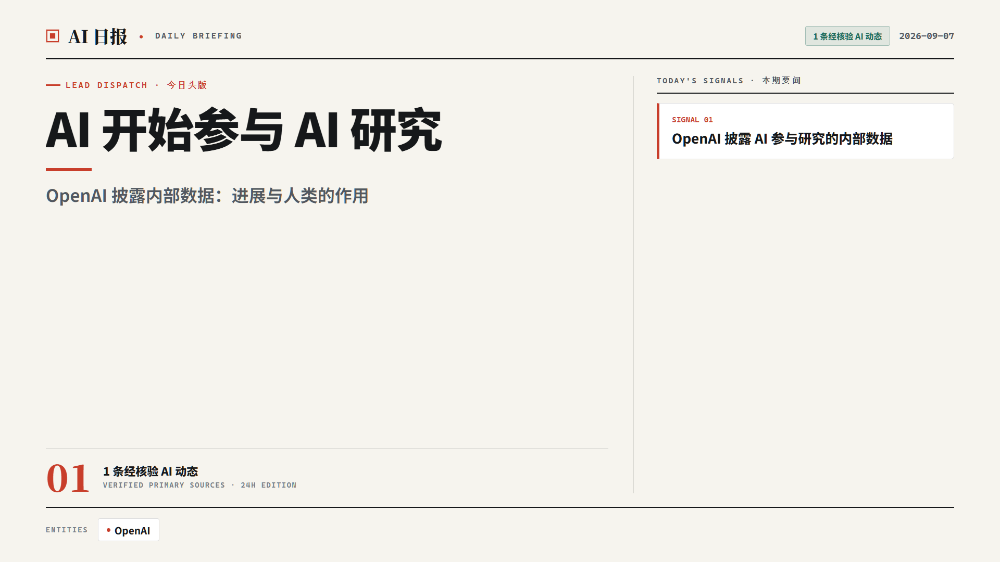
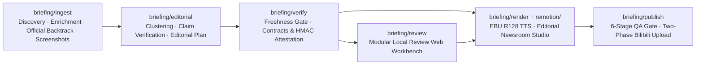
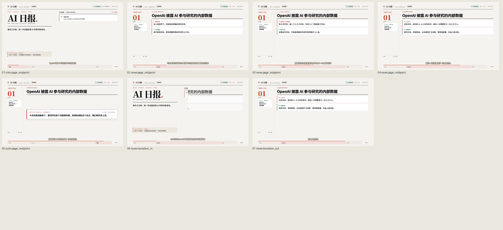

# AI Daily Briefing

> An evidence-first, auditable, cleanly layered automation pipeline that turns 24h of AI news into Chinese-language videos.

[**简体中文**](README.md) · English


AI Daily Briefing collects AI developments from the last 24 hours across official blogs, changelogs, model hubs, papers, media, and communities, turning them into Chinese videos where every claim is backed by traceable evidence. Instead of rewriting RSS blurbs, it runs source tiering, event clustering, official-source backtracking, atomic claim freezing, modular Editorial Newsroom Remotion rendering, and a 6-stage pre-publish gate.



## Architecture (v0.2 Layered Design)



| Package / Directory | Responsibility |
| --- | --- |
| `briefing/core/` | Typed domain models, config inheritance (`extends` / `source_filter`), SQLite WAL persistence, canonical AI brand/model registry, text/URL utilities, and PID-safe locks |
| `briefing/ingest/` | Multi-protocol discovery (RSS/Atom, Hugging Face, Google News, official web, audited social lanes), full-text enrichment, 1st/2nd-hop official reconciliation, and evidence screenshots |
| `briefing/editorial/` | Event clustering, atomic `FactClaim` verification, `EditorialPlan` + `Storyboard` synthesis, deterministic diversity selection, and single-pass package writing |
| `briefing/verify/` | 24h freshness & source-tier gate, review-render fingerprint contracts, 6-gate output verification, and clean-worktree HMAC-SHA256 release attestation |
| `briefing/review/` | Loopback Review Workbench (`web/` frontend with light/soft-slate color-scheme support, live speaking-rate & copy-hygiene linting, Cover Studio, and Provenance Inspector) |
| `briefing/render/` | Edge TTS / IndexTTS2 narration, EBU R128 loudness mastering (`-15 LUFS`), single-pass FFmpeg audio + subtitle burn, and 9:16 vertical / WeChat repurposing |
| `briefing/publish/` | Runtime `doctor`, read-only `automation_status` state machine, official crawler health audit, and Bilibili Open Platform two-phase upload |
| `remotion/` | Modular **Editorial Newsroom** studio (`types`, `theme`, `layout`, `chrome`, `scenes`, `cover`) with strict subtitle safe-zones and 4:3 + 16:9 covers |

## Quick Start

### Requirements

- Windows 10/11 (also runs and tests cleanly on macOS / Linux)
- Python 3.11+
- Node.js 22+
- FFmpeg (`ffmpeg` & `ffprobe`)

### Install

```powershell
powershell -ExecutionPolicy Bypass -File .\scripts\bootstrap.ps1
```

Or install manually:

```powershell
py -3 -m pip install -e .
npm --prefix .\remotion ci
```

### Runtime Check

```powershell
py -3 -m briefing doctor
```

## Unified CLI (8 Subcommands)

| Command | Description |
| --- | --- |
| `briefing run` | End-to-end pipeline (`collect -> verify -> render -> QA`, optional `--repurpose`, `--publish`) |
| `briefing prepare` | Collect, verify, and stage workspace (`--mode review\|agent\|draft`, `--append-morning`) |
| `briefing review` | Serve local Review Web Workbench (`127.0.0.1:8765`), or freeze manuscript with `--finalize` |
| `briefing render` | Render manuscript or sample fixture (`--quality 1080p\|4k`, `--tts edge\|indextts2`, `--visual-qa`, `--fixture`) |
| `briefing verify` | Run all 6 media, provenance, and copy-hygiene gates (`--complete-visual-qa` for agent runs) |
| `briefing publish` | Bilibili preflight dry-run by default (`--check-auth` token probe, `--execute` live upload) |
| `briefing repurpose` | Derive 9:16 vertical video + WeChat draft, or reclaim old media with `--prune-days N` |
| `briefing doctor` | Check prerequisites, `--status <run-dir>` automation stage, `--audit-sources`, or `--collect-x` |

### Common Commands

```powershell
# Run today's briefing with the public-web source edition
py -3 -m briefing run --date today --config .\sources.public-web.json

# Human-in-the-loop review workflow
py -3 -m briefing prepare --mode review --date today
py -3 -m briefing review --run-dir .\runs\YYYY-MM-DD
py -3 -m briefing render --run-dir .\runs\YYYY-MM-DD --quality 1080p

# Render the non-publishable design sample fixture
py -3 -m briefing render --fixture .\docs\examples\newsroom-2026-09-07.json --run-dir .\runs\preview

# Verify & preflight Bilibili submission
py -3 -m briefing verify --run-dir .\runs\YYYY-MM-DD
py -3 -m briefing publish --run-dir .\runs\YYYY-MM-DD --tid 231
```

## Run Artifacts (`runs/YYYY-MM-DD/`)

| File | Purpose |
| --- | --- |
| `final.mp4` | Final horizontal video with mastered 48kHz stereo narration and burned-in subtitles |
| `cover.png` / `cover-16x9.png` | 4:3 primary Bilibili cover and 16:9 widescreen cover anchored to the lead story |
| `subtitles.srt` | Clause-aligned Chinese SRT subtitles |
| `script.json` | Spoken script, visual beats, and measured chapter timings |
| `fact-check.md` / `sources.md` | Verified claims, risk tiers, and source health diagnostics |
| `bilibili.md` / `bilibili.json` / `pinned-comment.md` | Submission metadata, `MM:SS` chapters, and pinned discussion question |
| `manifest.json` / `run-state.json` | Machine-readable provenance, stage metrics, and SHA-256 bindings |
| `evidence-screenshots/` | Verified primary-source screenshots |



## Testing

```powershell
py -3 -m unittest discover -s tests -v
npm --prefix .\remotion test
npm --prefix .\remotion run typecheck
```

## License

[MIT License](LICENSE)
