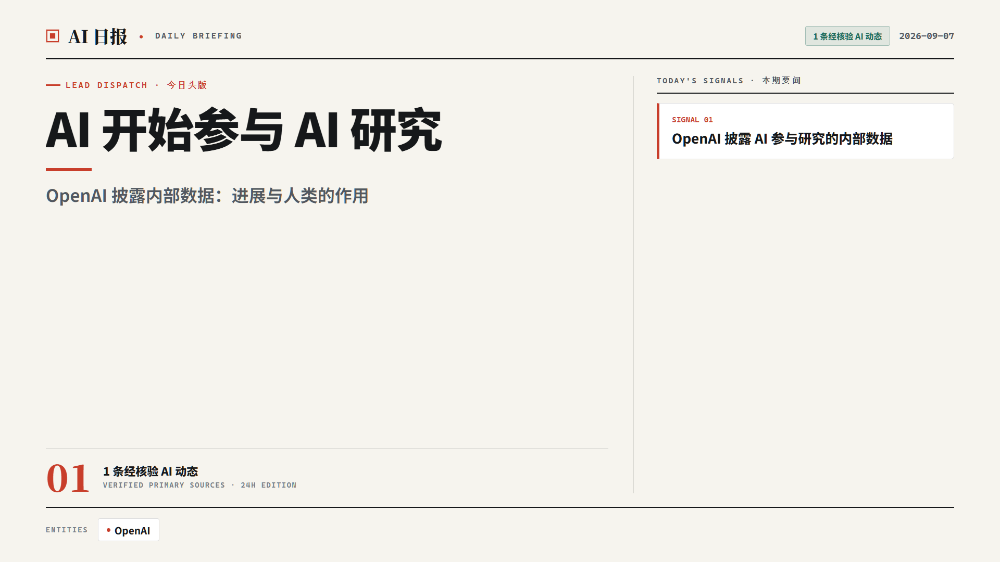
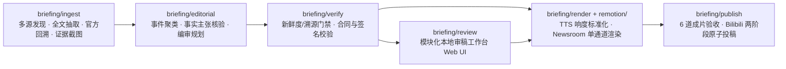
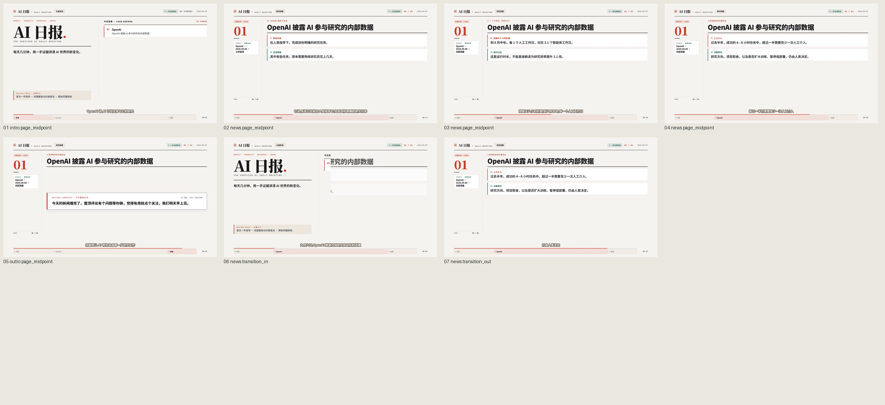

# AI Daily Briefing

> 一个证据优先、可审计、分层模块化的中文 AI 新闻视频自动化流水线。

中文 · **[English](README.en.md)**


AI Daily Briefing 把过去 24 小时分散在官网、更新日志、论文、媒体与社区中的 AI 动态，生产为每一条事实均可溯源、画面自带证据核验的中文新闻视频。它不把 RSS 摘要直接改写成口播，而是通过严格分层的流水线执行来源分级、事件聚类、官方源回溯、事实主张冻结、Editorial Newsroom 版式渲染与发布前 6 道验收门禁，最终输出可追溯的 Bilibili 投稿包。



## 架构设计（v0.2 分层体系）



| 子包 / 目录 | 核心职责 |
| --- | --- |
| `briefing/core/` | 统一领域模型、配置继承（`extends` / `source_filter`）、SQLite WAL 存储、AI 实体/模型注册表、文本/URL 标准化与进程锁 |
| `briefing/ingest/` | RSS/Atom、Hugging Face、Google News、官网动态与 Agent 社交线索采集，全文抽取、1/2 跳官方源回溯与证据截图捕获 |
| `briefing/editorial/` | 事件簇合并、原子 `FactClaim` 摘录核验、结构化 `EditorialPlan` 与 `Storyboard` 生成、多样性选题与投稿包单次原子写出 |
| `briefing/verify/` | 24 小时新鲜度与来源等级门禁、审稿—渲染指纹契约、成片 6 道验收门禁与洁净工作区 HMAC-SHA256 发布签名 |
| `briefing/review/` | 本地回环审稿工作台（独立 `web/` 前端：支持浅色纸感/深色石板自适应主题、实时口播语速与文案卫生检查、封面编辑与事实溯源抽查） |
| `briefing/render/` | Edge TTS / IndexTTS2 合成、EBU R128 响度标准化（`-15 LUFS`）、单次 FFmpeg 音轨+字幕压制、9:16 竖屏与公众号衍生导出 |
| `briefing/publish/` | 运行环境 `doctor` 自检、只读自动化状态机、官网爬虫健康审计与 Bilibili 开放平台两阶段防重投稿 |
| `remotion/` | 模块化 **Editorial Newsroom** 视觉引擎（`types` / `theme` / `layout` / `chrome` / `scenes` / `cover`），严格保障字幕安全区与双尺寸封面（4:3 & 16:9） |

## 快速开始

### 环境要求

- Windows 10/11（亦支持 macOS / Linux 本地运行与测试）
- Python 3.11+
- Node.js 22+
- FFmpeg（含 `ffprobe`）

### 一键初始化

```powershell
powershell -ExecutionPolicy Bypass -File .\scripts\bootstrap.ps1
```

也可手动安装：

```powershell
py -3 -m pip install -e .
npm --prefix .\remotion ci
```

### 环境自检

```powershell
py -3 -m briefing doctor
```

`doctor` 以 JSON 逐项检查 Python、依赖模块、Node 22+、FFmpeg、Remotion、本机浏览器、配置源与可选 Bilibili 凭据，并为未通过项提供修复指令。

## 统一 CLI（8 个子命令）

| 命令 | 用途 |
| --- | --- |
| `briefing run` | 全自动端到端运行（采集 → 核验 → 渲染 → 质量门禁，可选 `--repurpose`、`--publish`） |
| `briefing prepare` | 采集并生成工作区（`--mode review\|agent\|draft`，支持 `--append-morning` 早间增量合并） |
| `briefing review` | 启动本地审稿 Web 工作台（`127.0.0.1:8765`），或通过 `--finalize` 冻结定稿 |
| `briefing render` | 统一渲染定稿或设计样片（`--quality 1080p\|4k`、`--tts edge\|indextts2`、`--visual-qa`、`--fixture`） |
| `briefing verify` | 执行成片 6 道质量与溯源门禁（支持 `--complete-visual-qa` 关闭视觉审计并签名） |
| `briefing publish` | Bilibili 发布前预检（默认 dry-run，`--check-auth` 探测令牌，`--execute` 真实上传） |
| `briefing repurpose` | 导出 9:16 竖版视频与公众号图文草稿，或通过 `--prune-days N` 回收旧运行大体积媒体 |
| `briefing doctor` | 运行环境自检、`--status <run-dir>` 查询无人值守阶段、`--audit-sources` 审计官网爬虫、`--collect-x` 抓取候选 |

### 常用示例

```powershell
# 1. 全自动生成今日 1080p / 4K 快报（公开网页源配置）
py -3 -m briefing run --date today --config .\sources.public-web.json
py -3 -m briefing run --date today --quality 4k

# 2. 人工审稿工作流：准备审稿包 -> 打开浏览器审稿台 -> 渲染定稿
py -3 -m briefing prepare --mode review --date today
py -3 -m briefing review --run-dir .\runs\YYYY-MM-DD
py -3 -m briefing render --run-dir .\runs\YYYY-MM-DD --quality 1080p

# 3. 渲染非发布设计样片（不生成事实断言与发布许可）
py -3 -m briefing render --fixture .\docs\examples\newsroom-2026-09-07.json --run-dir .\runs\preview

# 4. 验收与 Bilibili 预检 / 上传
py -3 -m briefing verify --run-dir .\runs\YYYY-MM-DD
py -3 -m briefing publish --run-dir .\runs\YYYY-MM-DD --tid 231
py -3 -m briefing publish --run-dir .\runs\YYYY-MM-DD --tid 231 --execute
```

## 运行产物（`runs/YYYY-MM-DD/`）

| 文件 | 用途 |
| --- | --- |
| `final.mp4` | 最终横版视频（单通道合成 48kHz 立体声与安全区字幕） |
| `cover.png` / `cover-16x9.png` | Bilibili 4:3 主封面与 16:9 横版封面（默认锚定头条新闻） |
| `subtitles.srt` | 句级对齐中文字幕 |
| `script.json` | 含真实时间戳的口播、卡片与证据页时间轴 |
| `fact-check.md` / `sources.md` | 事实核查链路、风险等级与来源健康报告 |
| `bilibili.md` / `bilibili.json` / `pinned-comment.md` | 标题、简介章节时间轴、标签与置顶互动问题 |
| `manifest.json` / `run-state.json` | 机器可读溯源清单、阶段状态与 SHA-256 契约哈希 |
| `evidence-screenshots/` | 经校验的一手网页/原帖证据截图 |



## 质量门禁

任何进入发布环节的运行包都必须通过 6 道硬性检查（任一关键项失败时 `publish_allowed` 保持为 `false`）：

1. **时效与首发时间**：核对正文最早发布时间与 X Snowflake 时间戳，阻断旧闻重浮现与未来时间。
2. **一手源与分级披露**：区分官方确认（绿）、媒体/论文保守采用（黄）与社交一线/社区风向（强制显著免责声明与原帖截图）。
3. **文案卫生与无省略号**：零标题党措辞、零省略号（`…`/`...`）、零未闭合括号与裸英文长句；单条不合格自动剔除补选。
4. **画面与证据可见性**：每张必需证据截图均通过 SHA-256 绑定至成片渲染清单，严格避开底部字幕安全区。
5. **媒体与音频标准**：`yuv420p`、48kHz 立体声、`-16..-14 LUFS` 响度、`TP <= -1.5 dBTP` 且低静音占比。
6. **两阶段防重上传**：Bilibili 投稿前快照校验全部核心文件哈希，中断在 `submitting` 状态时自动阻断重投并提示人工核查。

## 测试

```powershell
py -3 -m unittest discover -s tests -v
npm --prefix .\remotion test
npm --prefix .\remotion run typecheck
```

## 仓库安全边界

公开仓库仅包含源码、测试、示例配置与脱敏展示素材。以下内容始终保留在本机 Git 忽略目录中：
- `.env`、开放平台凭据、Cookie 与 `.local/` 专用浏览器配置
- `runs/`、`data/`、`logs/` 数据库与每日运行产物
- 未获公开分发授权的第三方音色或素材

安全问题请通过 GitHub Private Vulnerability Reporting 反馈，详见 [SECURITY.md](SECURITY.md)。

## License

[MIT License](LICENSE)
